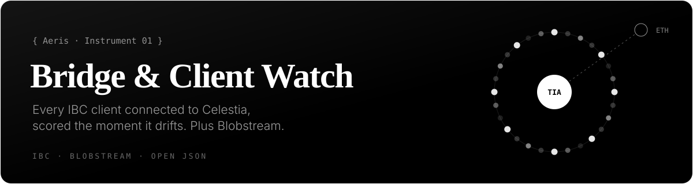

<a href="https://aerisvalidator.space/bridge/"></a>

# Bridge & Client Watch

Celestia keeps about 180 IBC light clients open to other chains, plus one bridge to Ethereum: Blobstream. A light client expires quietly if nobody relays a header to it within its trusting period, and bringing it back takes an on-chain governance proposal (`MsgRecoverClient`).

Bridge & Client Watch reads every one of those clients and the Blobstream contract directly from chain data, scores them, and publishes the result as one open JSON file. The idea is to see a problem while it is still a relayer problem, not a governance one.

**Live:** [aerisvalidator.space/bridge](https://aerisvalidator.space/bridge/) · **Data:** [`bridge_monitor.json`](https://aerisvalidator.space/bridge/api/bridge_monitor.json) · **API reference:** [docs/api.md](docs/api.md)

## What it measures

| Reading | Where it comes from |
|---|---|
| Every IBC light client, grouped by counterparty chain | Celestia's own IBC module through a public LCD (`/ibc/core/client/v1`) |
| Live transfer channels and the TIA held in their escrow accounts | `/ibc/core/channel/v1`, `/ibc/apps/transfer/v1` and bank balances of each escrow address |
| Blobstream's relayed height and its lag behind Celestia | `latestBlock()` read with `eth_call` from the SP1Blobstream contract [`0x7Cf3…08fAe`](https://etherscan.io/address/0x7Cf3876F681Dbb6EdA8f6FfC45D66B996Df08fAe) on Ethereum mainnet |
| Recent IBC transfers and per-chain volume | Celestia RPC `tx_search` |
| Risk transitions over time | Bridge & Client Watch's own event log |

Nothing is estimated or assumed. If a source can't be read, the reading says so.

## Risk levels

Each chain is scored by its **best** client: a chain with one healthy client and ten abandoned ones from old relayer setups is fine, not at risk. Abandoned clients are still counted.

| Level | Meaning |
|---|---|
| `healthy` | The connection to Celestia is solid. |
| `watch` | The trust window is getting low. A header relay soon would be wise. |
| `critical` | Close to expiry. Likely to need a relay very soon. |
| `frozen` | Misbehaviour was detected; the protocol itself froze the client. |
| `expired` | No live client left. Reviving the connection needs a governance `MsgRecoverClient`. |

Only real changes between levels are logged as events. A chain that stays at the same level produces one entry, not one per check. The same events feed Aeris's [Signal Feed](https://github.com/Aeris-io/signal-feed).

## Blobstream

The monitor keeps its own history of Blobstream lag and looks at its shape, not just its size. A lag that only ever grows, at an almost constant rate, is the signature of a relayer that has posted nothing at all rather than one that is merely slow. That is reported as `looks_like_total_relay_stall` in [`blobstream_lag_analysis`](docs/api.md#blobstream_lag_analysis).

## Quick start

No key, no sign-up. The file is rebuilt about every 30 minutes.

```sh
# how far Blobstream is behind Celestia, in hours
curl -s https://aerisvalidator.space/bridge/api/bridge_monitor.json | jq .blobstream.lag_estimated_hours

# counterparty chains whose best client has expired
curl -s https://aerisvalidator.space/bridge/api/bridge_monitor.json \
  | jq -r '.ibc.chains[] | select(.primary_risk=="expired") | .chain_id'

# TIA held in live transfer channels, network-wide
curl -s https://aerisvalidator.space/bridge/api/bridge_monitor.json \
  | jq '.ibc.total_escrowed_utia_network / 1e6'
```

More in [`examples/`](examples):

- [`expiring_clients.py`](examples/expiring_clients.py) lists chains ordered by how much trust window their best client has left.
- [`blobstream_lag.sh`](examples/blobstream_lag.sh) prints the current Blobstream lag and whether it looks like a stall.

## License

Docs and examples: [MIT](LICENSE). The data itself is read from public chains and is free to reuse.

---

<sub>Part of <a href="https://github.com/Aeris-io">Aeris</a> · <a href="https://aerisvalidator.space/">aerisvalidator.space</a></sub>
